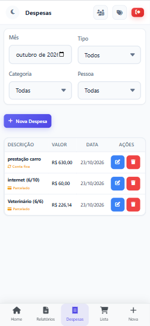

# 💰 Financeiro Família — Controle e Divisão de Gastos

Aplicação web para organização financeira de casais e famílias, desenvolvida com Python, Flask e SQLite.

O sistema permite registrar despesas individuais e compartilhadas, acompanhar gastos por categoria e calcular o saldo de cada integrante na divisão das despesas. Também oferece lista de compras, relatórios e controle de despesas fixas e parceladas.

## Contexto e objetivo

Desenvolvi este sistema para organizar os gastos da minha casa e facilitar a divisão das despesas entre mim e minha esposa.

Como muitas compras são realizadas no meu cartão de crédito, precisávamos acompanhar quanto cada um havia pago e calcular o valor necessário para equilibrar os gastos no início do mês.

No sistema, cada compra possui um responsável e pode ser registrada como individual ou compartilhada. Assim, as compras realizadas por ambos entram no cálculo da divisão, permitindo visualizar quem deve contribuir e quem possui valor a receber.

## Situação do projeto

**Em uso e em evolução.**

A aplicação é utilizada na organização financeira doméstica e recebe melhorias conforme as necessidades identificadas no dia a dia.

## Principais funcionalidades

- Cadastro e autenticação de usuários.
- Perfis de administrador e usuário comum.
- Administração dos integrantes da família.
- Registro de despesas com descrição, valor, data e responsável.
- Classificação de despesas como individuais ou compartilhadas.
- Cálculo da divisão dos gastos compartilhados.
- Exibição de valores a contribuir ou receber por integrante.
- Organização das despesas por categoria.
- Controle de despesas fixas e parceladas.
- Consulta de próximas parcelas.
- Filtros por mês, tipo, categoria e pessoa.
- Edição e exclusão de despesas.
- Dashboard com indicadores financeiros.
- Gráficos de gastos por categoria e evolução mensal.
- Consulta de movimentações recentes.
- Relatórios financeiros.
- Lista de compras com marcação de itens comprados.
- Interface responsiva para utilização pelo celular.

## 📸 Demonstração do sistema

Clique nas imagens para consultar os arquivos em tamanho maior.

### Visão geral

Dashboard com seleção de mês e ano, total do período e separação entre despesas compartilhadas e individuais.

<a href="tela%20inicial%281%29.png">
  
</a>

### Despesas fixas e parceladas

Indicadores para acompanhar despesas fixas, parcelamentos, comparação mensal e previsão de gastos do próximo mês.

<a href="tela%20inicial2.png">
  
</a>

### Divisão dos gastos compartilhados

Resumo dos valores pagos por cada integrante, da participação ideal na divisão e do saldo a contribuir ou receber.

<a href="tela%20inicial%20-%20divis%C3%A3o%20de%20gastos.png">
  
</a>

### Gráficos financeiros

Visualização da distribuição dos gastos por categoria e da evolução mensal das despesas.

<a href="tela%20inicial%20-%20gr%C3%A1ficos.png">
  
</a>

### Movimentações e próximas parcelas

Consulta das movimentações recentes e dos próximos lançamentos de despesas parceladas e fixas.

<a href="tela%20inicial%20-%20movimenta%C3%A7%C3%B5es.png">
  
</a>

### Registro de uma nova compra

Formulário para informar descrição, valor, data, categoria, responsável e tipo da despesa, com opção de compra no cartão de crédito.

<a href="nova%20compra.png">
  
</a>

### Gerenciamento de despesas

Listagem com filtros por mês, tipo, categoria e pessoa, além de opções para editar e excluir registros.

<a href="despesas.png">
  
</a>

### Lista de compras

Organização dos itens que precisam ser comprados, com quantidade, categoria, observações e marcação de conclusão.

<a href="lista%20de%20compras.png">
  
</a>

## Como funciona a divisão dos gastos

As despesas compartilhadas do mês são somadas e divididas igualmente entre os integrantes considerados no cálculo.

O sistema compara essa participação ideal com o valor que cada pessoa já pagou em despesas compartilhadas.

| Situação do integrante | Resultado |
|---|---|
| Pagou mais do que sua participação ideal | Possui saldo a receber. |
| Pagou menos do que sua participação ideal | Precisa contribuir com a diferença. |
| Pagou exatamente sua participação ideal | Está com a divisão equilibrada. |

### Exemplo de divisão entre duas pessoas

| Informação | Valor |
|---|---:|
| Pessoa A pagou | R$ 1.200,00 |
| Pessoa B pagou | R$ 400,00 |
| Total compartilhado | R$ 1.600,00 |
| Participação ideal de cada pessoa | R$ 800,00 |

Nesse exemplo, a Pessoa B deve repassar **R$ 400,00** à Pessoa A para equilibrar a divisão.

As despesas individuais são acompanhadas separadamente e não entram nesse rateio.

Para famílias com mais integrantes, o painel apresenta o saldo de cada pessoa em relação à sua participação ideal.

O sistema calcula os valores para o acerto entre os integrantes; não realiza transferências bancárias.

## Perfis de acesso

| Perfil | Responsabilidades |
|---|---|
| Administrador | Gerenciar integrantes da família e configurações administrativas, além de utilizar os recursos financeiros. |
| Usuário comum | Utilizar os recursos de registro e acompanhamento financeiro, sem acesso às configurações administrativas. |

O controle de acesso diferencia as atividades do dia a dia das funções de administração da família.

## Fluxo de utilização

1. Configurar os integrantes da família pelo perfil administrador.
2. Organizar as categorias de despesas.
3. Registrar cada compra com valor, data e responsável.
4. Classificar a despesa como individual ou compartilhada.
5. Informar as condições de recorrência ou parcelamento, quando aplicáveis.
6. Consultar o dashboard e os relatórios do período.
7. Verificar os saldos da divisão dos gastos compartilhados.
8. Realizar o acerto financeiro entre os integrantes fora da aplicação.

## Organização por categorias

As categorias ajudam a identificar onde o dinheiro está sendo gasto.

Cada despesa pode ser associada a uma categoria, permitindo consultar os registros por filtro e visualizar sua participação nos gráficos.

Essa organização facilita o acompanhamento dos hábitos de consumo da família.

## Despesas fixas e parceladas

O sistema diferencia despesas comuns, recorrentes e parceladas.

| Tipo | Finalidade |
|---|---|
| Despesa comum | Registrar uma compra ou gasto pontual. |
| Despesa fixa ou recorrente | Acompanhar gastos que se repetem. |
| Despesa parcelada | Distribuir uma compra em parcelas e acompanhar os próximos lançamentos. |

O dashboard reúne informações sobre o mês selecionado e os próximos compromissos financeiros.

## Lista de compras

A lista de compras permite:

- Adicionar itens que precisam ser comprados.
- Informar quantidade e categoria.
- Registrar observações.
- Consultar quem adicionou o item.
- Marcar itens como comprados.
- Excluir itens da lista.

A lista apoia o planejamento das compras, enquanto as despesas registram os gastos realizados.

## Relatórios e indicadores

O sistema oferece recursos para acompanhar:

- Total de despesas do período.
- Valores individuais e compartilhados.
- Gastos por integrante.
- Distribuição dos gastos por categoria.
- Evolução mensal.
- Despesas fixas e parceladas.
- Movimentações recentes.
- Previsão de gastos do próximo mês.
- Saldos da divisão dos gastos compartilhados.

## Tecnologias

| Camada | Tecnologias |
|---|---|
| Backend | Python e Flask |
| Banco de dados | SQLite |
| Acesso aos dados | Módulo sqlite3 do Python |
| Autenticação | Sessões do Flask e hash de senhas com Werkzeug |
| Interface | HTML, CSS e JavaScript |
| Templates | Jinja2 |
| Versionamento | Git e GitHub |

## Organização do código

A aplicação concentra as rotas no arquivo principal e separa os modelos, templates e arquivos estáticos.

```text
app.py
requirements.txt

models/
├── __init__.py
├── database.py
├── user.py
├── category.py
├── expense.py
└── shopping_item.py

templates/
├── base.html
├── login.html
├── register.html
├── dashboard.html
├── expenses.html
├── expense_form.html
├── reports.html
├── shopping.html
├── categories.html
└── admin_users.html

static/
├── css/
│   └── style.css
└── js/
    └── main.js

database/
```

- **app.py:** configuração da aplicação, rotas e processamento das operações.
- **models/database.py:** conexão com SQLite e criação das tabelas.
- **models:** módulos relacionados a usuários, categorias, despesas e lista de compras.
- **templates:** páginas da interface.
- **static:** estilos e interações do frontend.
- **database:** armazenamento do banco local.
- **requirements.txt:** dependências Python.

## Aspectos técnicos do projeto

- Modelagem de usuários, categorias, despesas e itens de compras.
- Identificação do responsável por cada despesa.
- Separação entre gastos individuais e compartilhados.
- Cálculo da participação ideal e do saldo por integrante.
- Controle de permissões administrativas.
- Persistência dos dados em SQLite.
- Geração de lançamentos recorrentes e parcelados.
- Filtros para consulta das despesas.
- Apresentação de indicadores e gráficos.
- Formatação de datas e valores para o padrão brasileiro.
- Interface adaptada ao uso pelo celular.

## Execução local

### 1. Clonar o repositório

```bash
git clone https://github.com/LovanGoulart/financeiro-familia.git
cd financeiro-familia
```

### 2. Criar um ambiente virtual

```bash
python -m venv .venv
```

### 3. Ativar o ambiente virtual

**Windows — Git Bash:**

```bash
source .venv/Scripts/activate
```

**Windows — Prompt de Comando:**

```bat
.venv\Scripts\activate.bat
```

**Linux ou macOS:**

```bash
source .venv/bin/activate
```

### 4. Instalar as dependências

```bash
python -m pip install -r requirements.txt
```

### 5. Iniciar a aplicação

```bash
python app.py
```

### 6. Acessar no navegador

```text
http://localhost:5000
```

A aplicação utiliza SQLite e inicializa as tabelas durante a execução.

A porta padrão é 5000 e pode ser alterada pela variável de ambiente `PORT`.

### Configuração para publicação

Configure uma chave de sessão própria por meio da variável de ambiente `SECRET_KEY`.

A publicação em produção exige configuração de hospedagem adequada e preservação dos dados e credenciais fora do repositório público.

## Autor

Desenvolvido por **Lovan Goulart** para organizar as finanças da casa e facilitar a divisão dos gastos entre os integrantes da família.

[Perfil no GitHub](https://github.com/LovanGoulart)
